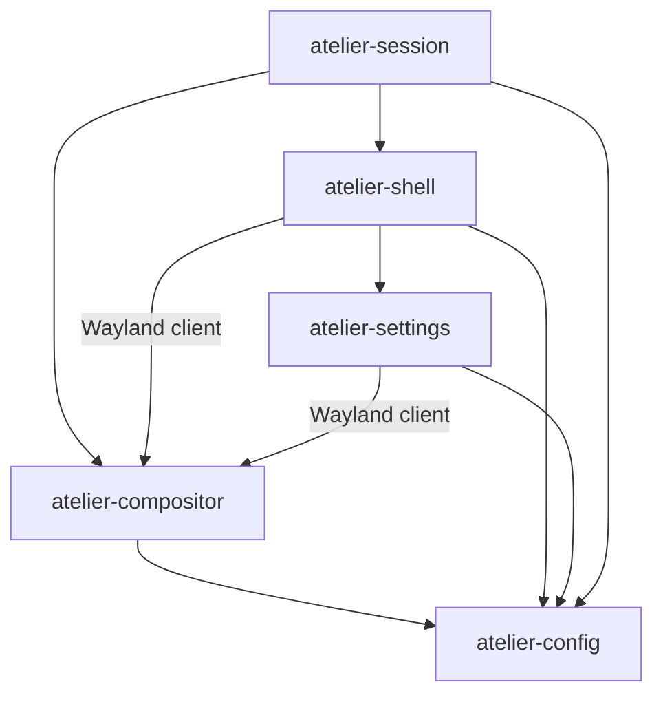

# Native architecture and milestone gates

Atelier's native DE is a fresh Rust workspace. MangoWM, Hyprland and Niri integrations remain separate compatibility/distribution projects. They are not runtime dependencies or fallback engines.

## Boundaries

- The compositor owns protocol state, surface lifecycle, focus, input dispatch, output and frame scheduling. The nested backend is an adapter; hardware access belongs in another backend, not in shell code.
- The shell owns presentation and application discovery. It is a regular Wayland client today. Layer-shell, status widgets, dock, notification centre, launcher overlays and quick settings will be built here once their Wayland/service contracts exist.
- The session supervisor owns startup/shutdown of its own child processes. It is not a privileged service manager. It does not globally rewrite environment variables, systemd user configuration, display-manager files or other desktops.
- Settings validates/persists shared user choices. Settings will eventually consume explicit output/input appearance APIs rather than writing compositor-specific configuration files. It must not run privileged commands implicitly.
- Shared config uses an explicit version, defaults, XDG paths and same-directory atomic replacement. It contains only preferences that current components consume.

## Milestone 1 — Nested native bring-up (this change)

Implementation includes a native Wayland listening socket, standard compositor/SHM/xdg-shell/seat/output globals, nested GLES rendering and cascaded client windows, keyboard and pointer routing, basic popup tracking, launcher window, independent settings UI and process supervision. Explicit popup grabs are refused until proper grab validation is implemented. Client cursor rendering, touch, drag-and-drop semantics, Xwayland and production damage scheduling are not acceptance claims.

Acceptance gates (run before marking milestone complete):

1. Build/check and unit tests pass on Linux with pinned Smithay 0.7.0; record host/toolchain and a resolved Cargo.lock.
2. Nested smoke succeeds: `wayland-info` lists compositor, SHM, xdg shell, seat and output, and supervisor shutdown reaps children.
3. Start multiple ordinary Wayland clients, verify painting, focus, key entry, clicks, scrolling and resize of the host window. Check clipping, repeat keyboard events, focus when clients close and client buffer detach/remap.
4. Launcher searches installed desktop entries and launches a native app in the nested display; Settings persists and reloads a changed theme, terminal and startup choice. An invalid config is reported without overwrite.

The first milestone is implementation in progress until these checks are executed on a graphical Linux host. No TTY/login installation until hardware bring-up passes.

## Milestone 2 — Compositor foundations

- Move from polling to calloop sources and damage-driven rendering; verify idle CPU and frame pacing.
- Introduce backend-independent window/output/layout policy; implement floating/tiling workspace model, move/resize, keybindings, focus stack, client constraints, and proper multi-output handling.
- Complete xdg popup positioning/grabs, cursor rendering, clipboard/selection and DnD; add Wayland protocol integration tests. Add layer-shell for desktop surfaces, including exclusive zones and keyboard interactivity.
- Add DRM/KMS/GBM, libinput and libseat/logind backend and session pause/resume. Test in a real TTY (including GPU reset, suspend/resume, monitor hotplug, mixed DPI); no display manager handoff until hardware gates pass.

## Milestone 3 — Desktop shell and services

- Develop layer-shell dock/panel, keyboard command palette, searchable app grid, overview, wallpaper and widget surfaces. Use Atelier's design language: Caelestia-inspired interactions and Serpantinum-inspired controls; no runtime dependency on either.
- Build separate user services for notifications, media (MPRIS), audio (PipeWire/WirePlumber), network (NetworkManager), battery (UPower), power (logind) and appearance. Use standard D-Bus/Wayland interfaces; establish a small typed Atelier IPC only for native window/workspace state.
- Introduce bounded restart policies, startup graph, service health and user-session logs. Integrate xdg-desktop-portal and screen capture under explicit user consent.
- Implement a standards-based session-lock protocol and locker before exposing a lock-screen action. A fullscreen shell overlay is never a security lock.

## Milestone 4 — System settings and visual editor

- Display/input, appearance, wallpaper, dock/widgets, shortcuts, applications, notifications, network, audio, accessibility and power pages.
- Add transactional config updates, live notifications with a schema version, rollback and accessible preview workflows; do not interpret arbitrary downloaded theme scripts.
- Add safe DRM output configuration preview/confirm/revert; use privilege brokers such as polkit for genuinely privileged actions and explain each action.
- System installation packages and login-session desktop entry are gated on DRM, suspend, multi-monitor, security and recovery tests on real hardware.

## Independent development

`cargo run -p atelier-settings` and `cargo run -p atelier-shell` can be tested in the host desktop without running Atelier's compositor. The compositor does not link the GUI toolkit, and the settings UI does not link the compositor. Keep contracts explicit and avoid a shared monolithic state object across processes.
